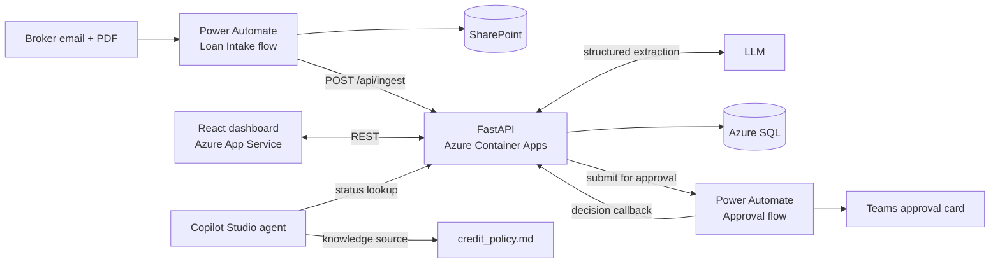

# LoanLens — Commercial Loan Intake Assistant

> **Status: in development.** Sections marked _TBC_ are filled in as each stage is built and measured. Nothing below is claimed as a result until it has been run.

Loan applications arrive by email as messy PDFs. LoanLens uses an LLM to read the key loan details out of each document, checks them against credit policy with plain deterministic code, flags risks with confidence scores, and routes everything through a human review dashboard and a Microsoft Teams approval. Credit staff spend minutes, not hours, on intake — and the AI never makes the final call.

**Demo video:** _TBC_ · **Live demo:** _TBC_

All borrowers, brokers, addresses and policy figures in this repository are fictional.

---

## The problem

A credit analyst at a commercial property lender receives loan applications from brokers by email. Each one is a PDF in a different layout. Before any credit thinking can start, the analyst re-keys a dozen figures into the loan system and checks them by hand against the credit policy. It is slow, it is boring, and a mistyped valuation or a missed policy limit is expensive.

The background, the users and the success measures are written up in [docs/discovery.md](docs/discovery.md).

## What it does

1. A broker emails an application PDF to a shared mailbox.
2. A Power Automate flow files the PDF in SharePoint and posts it to the LoanLens API.
3. The API extracts the text and asks an LLM to fill a fixed schema: borrower, loan amount, property value, term and so on. Every field comes back with a value, a confidence score, and a quote from the document that supports it.
4. The API checks that each quote really appears in the document, then runs the credit policy rules in ordinary Python.
5. An analyst opens the review page: the original PDF on the left, the extracted fields on the right. Uncertain fields are amber, policy breaches are red. The analyst corrects what is wrong and acknowledges the risks.
6. The analyst sends it for approval. A credit manager approves or rejects in Teams, and the status and audit trail update automatically.

A Copilot Studio agent in Teams answers questions about the credit policy and looks up application status.

## Architecture

Inside the API, one application goes through these steps in order:

| Step | What happens | Done by |
|---|---|---|
| 1. Text extraction | PDF pages and tables become text, with page numbers kept | Code |
| 2. Field extraction | The LLM fills a fixed schema; each field carries value, confidence, evidence quote and page | LLM |
| 3. Grounding check | Each evidence quote is matched against the document text; no match means the field is distrusted | Code |
| 4. Policy rules | LVR, loan size, term, valuation age, presales and ABN checks | Code |
| 5. Qualitative review | The LLM reads the application against the policy and lists soft risks, each citing a policy section | LLM |
| 6. Scoring | Confidence and flags decide whether the application needs human review | Code |
| 7. Save | Fields, flags, the AI's original values and every later human edit go to the database and audit log | Code |

## Guardrails and responsible AI

- **A human makes every decision.** The system has no path that approves or declines a loan on its own.
- **Every extracted value must show its source.** If the quote the LLM gives cannot be found in the document, the field's confidence is capped low and the application is forced into review.
- **Numbers are judged by code, not by the model.** The LLM reads figures out of documents; Python decides whether they breach policy. LVR is recalculated from loan amount and property value and compared with what the document claims.
- **The LLM cannot raise a critical flag.** Critical flags come only from deterministic rules. LLM-raised risks are capped at warning and are dropped unless they cite a policy section.
- **Conservative confidence.** An application's overall confidence is the lowest confidence among its required fields, not the average.
- **Full audit trail.** The AI's original value, each human edit, who approved and when are all recorded.
- **Privacy.** Names, phone numbers, emails and ABNs are redacted from logs. Secrets live in environment variables and Azure secrets, never in the repository.
- **Public demo is read-only.** Uploading and editing on the live demo need a passcode, so the link cannot be used to run up LLM costs.

## Where AI is deliberately not used

| Task | Why not AI |
|---|---|
| Deciding whether a figure breaches policy | It is arithmetic with a fixed threshold. Code is exact, testable and free. |
| Calculating LVR | Same reason. The model's own arithmetic is not trusted. |
| Retrieval over the credit policy | The policy is a few pages. It fits in the prompt whole, so a vector search would add moving parts and no benefit. |
| Approving or declining | A credit decision needs an accountable person. |

## Results

_TBC — produced by `backend/scripts/evaluate.py` against the sample set._

| Measure | Result |
|---|---|
| Field-level accuracy | _TBC_ |
| Correct handling of missing fields | _TBC_ |
| Grounding failures | _TBC_ |
| Expected policy flags raised | _TBC_ |
| Average processing time per application | _TBC_ |
| Average LLM cost per application | _TBC_ |

The sample set is ten synthetic applications in several layouts, generated for this project. It shows that the pipeline works and where it fails; it is not evidence of accuracy on real broker documents. A failure analysis will sit alongside the numbers.

## Design decisions

**Why deterministic rules instead of asking the LLM to assess policy compliance.** A rule such as "LVR above 65% on an investment property" has one right answer. Code gives that answer every time, can be unit tested, and can be read by an auditor. An LLM adds cost and a small chance of being wrong, for nothing in return.

**Why evidence quotes.** A confidence score from a model is only the model's opinion of itself. A quote that can be checked against the source is something the system can verify without trusting the model, and something the analyst can see with their own eyes.

**Why the minimum confidence, not the mean.** One badly wrong field can sink a credit decision. Averaging would let eleven confident fields hide one doubtful loan amount.

**Why Power Automate for the email and approval steps.** The mailbox, the document library and the approver already live in Microsoft 365. Power Automate reaches them with managed connectors, and Teams approvals bring mobile access, delegation and their own history without any custom code. The API stays a plain web service that knows nothing about mailboxes.

**Why a provider interface around the LLM.** The model name and provider come from configuration. Switching model is a config change, which keeps the choice open as price, quality and data-residency requirements change.

**Model choice and cost.** _TBC — a short comparison based on measured tokens, latency and accuracy from the evaluation run._

## Tech stack

| Layer | Choice |
|---|---|
| Backend | Python 3.12, FastAPI, Pydantic v2, SQLAlchemy 2 |
| PDF | pdfplumber to read, reportlab to generate the samples |
| LLM | Anthropic Claude API behind a provider interface; model set by environment variable |
| Database | SQLite locally, Azure SQL when deployed |
| Frontend | React, TypeScript, Vite, TanStack Query, shadcn/ui, Tailwind |
| Automation | Power Automate (Outlook, SharePoint, Teams Approvals, HTTP), Copilot Studio |
| Hosting | Docker, Azure Container Apps (API), Azure App Service (frontend) |
| CI/CD | GitHub Actions |
| Tests | pytest |

## Run locally

_TBC_

## Limitations and next steps

- Text PDFs only. Scanned documents need OCR, which is not built.
- No user accounts or roles; the demo uses a single shared passcode for writes.
- The evaluation set is small and synthetic. A real rollout would start with a labelled set of past applications.
- No integration with a loan origination system; approved applications stop at the dashboard.

## How this was built

LoanLens was built with Claude Code as the main development tool. The conventions the assistant works to are in [CLAUDE.md](CLAUDE.md).
