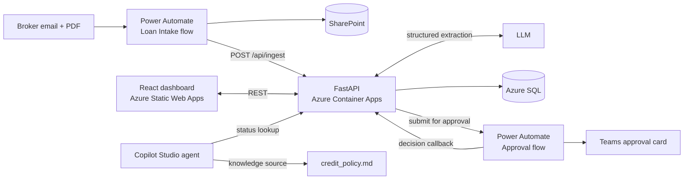

# LoanLens — Commercial Loan Intake Assistant

> **Status: in development.** Sections marked _TBC_ are filled in as each stage is built and measured. Nothing below is claimed as a result until it has been run.

Loan applications arrive by email as messy PDFs. LoanLens uses an LLM to read the key loan details out of each document, checks them against credit policy with plain deterministic code, flags risks with confidence scores, and routes everything through a human review dashboard and a Microsoft Teams approval. Credit staff spend minutes, not hours, on intake — and the AI never makes the final call.

**Demo video:** _TBC_ · **Live demo:** [kind-dune-0aa634900.6.azurestaticapps.net](https://kind-dune-0aa634900.6.azurestaticapps.net) (read-only; the first visit after a quiet spell can take up to a minute while it wakes up)

All borrowers, brokers, addresses and policy figures in this repository are fictional.

---

## The problem

A credit analyst at a commercial property lender receives loan applications from brokers by email. Each one is a PDF in a different layout. Before any credit thinking can start, the analyst re-keys a dozen figures into the loan system and checks them by hand against the credit policy. It is slow, it is boring, and a mistyped valuation or a missed policy limit is expensive.

The background, the users and the success measures are written up in [docs/discovery.md](docs/discovery.md).

## What it does

1. A broker emails an application PDF to a shared mailbox.
2. A Power Automate flow files the PDF in SharePoint and posts it to the LoanLens API.
3. The API extracts the text and asks an LLM to fill a fixed schema: borrower, loan amount, property value, term and so on. Every field comes back with a value, a confidence score, and a quote from the document that supports it.
4. The API checks that each quote really appears in the document, then runs the credit policy rules in ordinary Python.
5. An analyst opens the review page: the original PDF on the left, the extracted fields on the right. Uncertain fields are amber, policy breaches are red. The analyst corrects what is wrong and acknowledges the risks.
6. The analyst sends it for approval. A credit manager approves or rejects in Teams, and the status and audit trail update automatically.

A Copilot Studio agent in Teams answers questions about the credit policy and looks up application status.

## Architecture



Inside the API, one application goes through these steps in order:

| Step | What happens | Done by |
|---|---|---|
| 1. Text extraction | PDF pages and tables become text, with page numbers kept | Code |
| 2. Field extraction | The LLM fills a fixed schema; each field carries value, confidence, evidence quote and page | LLM |
| 3. Grounding check | Each evidence quote is matched against the document text; no match means the field is distrusted | Code |
| 4. Policy rules | LVR, loan size, term, valuation age, presales and ABN checks | Code |
| 5. Qualitative review | The LLM reads the application against the policy and lists soft risks, each citing a policy section | LLM |
| 6. Scoring | Confidence and flags decide whether the application needs human review | Code |
| 7. Save | Fields, flags, the AI's original values and every later human edit go to the database and audit log | Code |

## Guardrails and responsible AI

- **A human makes every decision.** The system has no path that approves or declines a loan on its own.
- **Every extracted value must show its source.** If the quote the LLM gives cannot be found in the document, the field's confidence is capped low and the application is forced into review.
- **Numbers are judged by code, not by the model.** The LLM reads figures out of documents; Python decides whether they breach policy. LVR is recalculated from loan amount and property value and compared with what the document claims.
- **The LLM cannot raise a critical flag.** Critical flags come only from deterministic rules. LLM-raised risks are capped at warning and are dropped unless they cite a policy section.
- **Conservative confidence.** An application's overall confidence is the lowest confidence among its required fields, not the average.
- **Full audit trail.** The AI's original value, each human edit, who approved and when are all recorded.
- **Privacy.** Names, phone numbers, emails and ABNs are redacted from logs. Secrets live in environment variables and Azure secrets, never in the repository.
- **Public demo is read-only.** Uploading and editing on the live demo need a passcode, so the link cannot be used to run up LLM costs.

## Where AI is deliberately not used

| Task | Why not AI |
|---|---|
| Deciding whether a figure breaches policy | It is arithmetic with a fixed threshold. Code is exact, testable and free. |
| Calculating LVR | Same reason. The model's own arithmetic is not trusted. |
| Retrieval over the credit policy | The policy is a few pages. It fits in the prompt whole, so a vector search would add moving parts and no benefit. |
| Approving or declining | A credit decision needs an accountable person. |

## Results

Claude Opus 5.5 at medium effort, on the ten sample applications. Produced by `backend/scripts/evaluate.py`; full tables in [docs/eval_results.md](docs/eval_results.md).

| Measure | Result |
|---|---|
| Field-level accuracy | 159 / 160 (99%) |
| Missing fields correctly left empty | 22 / 23 |
| Values without a verifiable quote | 1 / 138 |
| Samples raising exactly the expected policy flags | 10 / 10 |
| Conflicting figures flagged as low confidence | 1 / 1 |
| Average AI time per application | 21 s (two model calls) |
| Average AI cost per application | US$0.06 |

**What went wrong, and what caught it**

- **One wrong value.** S06's letter says "the property is unencumbered", and the model recorded existing debt as $0. That is an inference, not something the document states. The grounding check caught it: the quote contains no figure, so the value was marked unverified, its confidence capped, and the application sent to review. This is the one unverified value in the table above.
- **Conflict detected.** S06 also gives the loan amount as "approximately $3.8m" in the letter and $4,100,000 in its summary table. The model took the table figure and scored it 0.40, so the application went to a person instead of through on a guess.
- **A false alarm, fixed.** In the first run a correct loan amount in S09 was marked unverified, because the model's quote stopped at a line break just before the figure. Grounding now accepts the figure only if it appears immediately after the quote. Two tests cover this, including one that a figure elsewhere on the page does not count.
- **Noise in the AI review, reduced.** The first run suggested "confirm the valuer is on the panel" for most applications. A point that applies to everything carries no information, so the review prompt now asks only for what this application gives a reason to raise. It dropped from most applications to two, each with a specific reason.

These are ten synthetic documents written for this project. They show the pipeline works and where it breaks; they are not evidence of accuracy on real broker documents.

## Design decisions

**Why deterministic rules instead of asking the LLM to assess policy compliance.** A rule such as "LVR above 65% on an investment property" has one right answer. Code gives that answer every time, can be unit tested, and can be read by an auditor. An LLM adds cost and a small chance of being wrong, for nothing in return.

**Why evidence quotes.** A confidence score from a model is only the model's opinion of itself. A quote that can be checked against the source is something the system can verify without trusting the model, and something the analyst can see with their own eyes.

**Why the minimum confidence, not the mean.** One badly wrong field can sink a credit decision. Averaging would let eleven confident fields hide one doubtful loan amount.

**Why Power Automate for the email and approval steps.** The mailbox, the document library and the approver already live in Microsoft 365. Power Automate reaches them with managed connectors, and Teams approvals bring mobile access, delegation and their own history without any custom code. The API stays a plain web service that knows nothing about mailboxes.

**Why a provider interface around the LLM.** The model name and provider come from configuration. Switching model is a config change, which keeps the choice open as price, quality and data-residency requirements change.

**Model choice and cost.** Claude Opus 5.5 at medium effort costs about six US cents and 21 seconds per application, for both model calls. At a few hundred applications a month that is tens of dollars, against an analyst's time on manual intake, so accuracy matters far more than model price. The evaluation script is the tool for revisiting this: point it at a cheaper model (Sonnet 5.5 is half the price) and keep it only if accuracy and the conflict-detection result hold. Answers are cached by document, so re-running an unchanged document costs nothing.

**Why structured output, and why the schema is a list.** The API guarantees the reply matches a JSON schema, which removes parsing failures. It also limits how complex that schema can be. The first design, one nested object per field with nullable values, was rejected by the API. The final schema is a list of identical "readings", each naming its field, so its size doesn't grow with the number of fields. Values come back as text and are converted and validated by our own code. A field the model leaves out is treated as not found, with zero confidence.

**Hosting: designed to cost nothing while idle.** The API runs on Azure Container Apps and scales to zero replicas when idle. The database is Azure SQL serverless on the free offer, set to pause rather than bill if the monthly allowance runs out. The front end is plain files on Azure Static Web Apps (free tier). The price of this is a cold start: the first visit after a quiet spell waits while the API and database wake up. The API retries its database connection while the database resumes, and the web page says it is waking up instead of showing an error.

**Releases without stored cloud passwords.** GitHub Actions signs in to Azure with OpenID Connect: Azure trusts a token that GitHub issues for this repository's main branch, so no Azure secret is kept in GitHub. Its permission is limited to the one resource group. Every release runs the tests first and deploys an image tagged with the commit, so it is always clear what is running and a rollback is pointing back at an older tag.

## Tech stack

| Layer | Choice |
|---|---|
| Backend | Python 3.12, FastAPI, Pydantic v2, SQLAlchemy 2 |
| PDF | pdfplumber to read, reportlab to generate the samples |
| LLM | Anthropic Claude API (Claude Opus 5.5 by default) behind a provider interface; model and effort set by environment variable |
| Database | SQLite locally, Azure SQL when deployed |
| Frontend | React, TypeScript, Vite, TanStack Query, Tailwind CSS, react-pdf, Recharts |
| Automation | Power Automate (Outlook, SharePoint, Teams Approvals, HTTP), Copilot Studio |
| Hosting | Docker, Azure Container Apps (API), Azure SQL serverless, Azure Static Web Apps (frontend) |
| CI/CD | GitHub Actions, GitHub Container Registry, OpenID Connect sign-in to Azure |
| Tests | pytest |

## Run locally

Needs Python 3.12+ and Node 20+. No API key is needed: by default a mock provider stands in for the LLM.

```bash
cd backend
python3 -m venv .venv && .venv/bin/pip install -e ".[dev]"
cp .env.example .env                       # set LLM_PROVIDER=anthropic and a key to use Claude
.venv/bin/python scripts/seed_db.py        # load the ten sample applications
.venv/bin/uvicorn app.main:app --reload    # API on http://localhost:8000/docs
```

```bash
cd frontend
npm install
npm run dev                                # app on http://localhost:5173
```

Viewing is open. To edit, upload or send for approval, click **Read-only** and enter the passcode (`DEMO_PASSCODE` in `.env`).

Tests and evaluation:

```bash
cd backend
.venv/bin/pytest                           # 69 tests
.venv/bin/python scripts/evaluate.py       # field accuracy against the ground truth
```

## Deploy to Azure

Everything is created by one script, [infra/deploy.sh](infra/deploy.sh), and released by one workflow, [.github/workflows/deploy.yml](.github/workflows/deploy.yml).

1. Push to `main`. GitHub Actions runs the tests and publishes the API image to GitHub Container Registry. Make the package public once, so Azure can pull it without a registry password.
2. `az login`, then run `infra/deploy.sh`. It sets budget alerts, then creates the resource group, the database, the API, the static web app and the GitHub sign-in, and loads the ten sample applications. Generated secrets are kept in `infra/.env.azure`, which is git-ignored.
3. Add the four repository variables the script prints, and re-run the workflow. From then on every push to `main` is tested and released.

To remove everything: `az group delete --name rg-loanlens-demo`.

## Limitations and next steps

- Text PDFs only. Scanned documents need OCR, which is not built.
- No user accounts or roles; the demo uses a single shared passcode for writes.
- The evaluation set is small and synthetic. A real rollout would start with a labelled set of past applications.
- No integration with a loan origination system; approved applications stop at the dashboard.
- The database uses a SQL login stored as a Container Apps secret. A production setup would use the app's managed identity, so there is no database password at all.
- The demo wakes from idle on the first visit, which is slow. A production deployment would keep one replica running and the database online.

## How this was built

LoanLens was built with Claude Code as the main development tool. The conventions the assistant works to are in [CLAUDE.md](CLAUDE.md).
